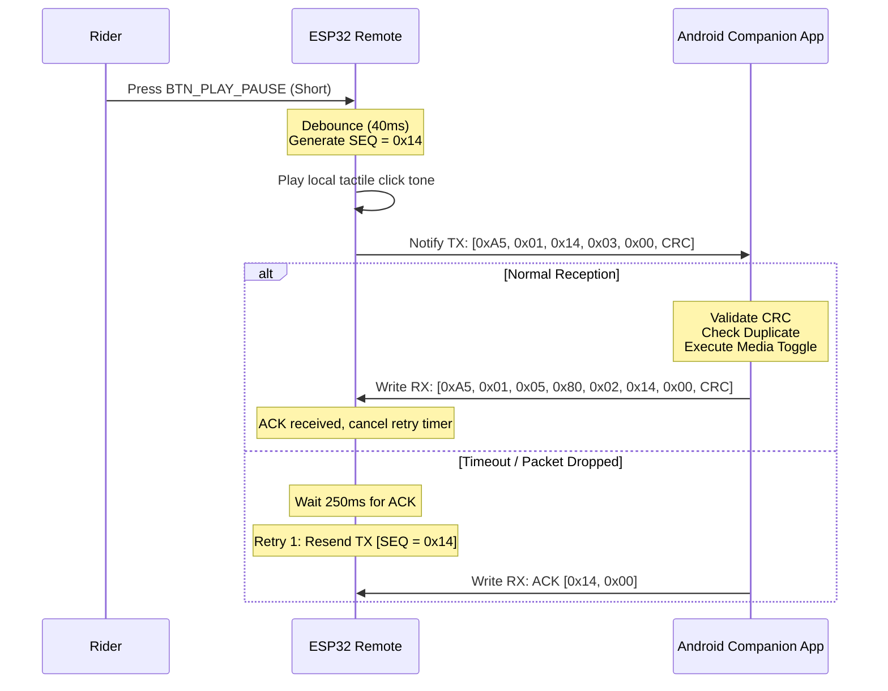

# BLE Protocol Specification — Smart Rider HMI

## 1. Overview & GATT Profile Architecture

The Smart Rider HMI system uses Bluetooth Low Energy (BLE 4.2 / 5.0) to provide low-latency, energy-efficient bidirectional communication between the handlebar remote (GATT Server / Peripheral) and the Android smartphone (GATT Client / Central).

### 1.1 Device Identity & Advertising
- **Device Advertised Name**: `SmartRider-Remote`
- **Advertising Interval**:
  - *Fast Advertising*: $100\text{ ms}$ interval for the first $30\text{ s}$ upon power-up or disconnection.
  - *Slow Advertising*: $1000\text{ ms}$ interval after $30\text{ s}$ to conserve battery while awaiting the rider.
- **Connection Supervision Timeout**: $4000\text{ ms}$.
- **Connection Interval**: Min $20\text{ ms}$, Max $40\text{ ms}$ (ensures button latency is $<50\text{ ms}$ end-to-end).
- **Slave Latency**: 4 connection events.

### 1.2 Custom GATT Service & Characteristics

All services and characteristics use 128-bit Universally Unique Identifiers (UUIDs) based on the project base namespace `4fafc200-1fb5-459e-8fcc-c5c9c331914b`:

| Entity | UUID | Type | Properties | Description |
| :--- | :--- | :--- | :--- | :--- |
| **Smart Rider Service** | `4fafc201-1fb5-459e-8fcc-c5c9c331914b` | Service | Primary | Main service container |
| **Command TX Characteristic** | `beb5483e-36e1-4688-b7f5-ea07361b26a8` | Characteristic | Read, Notify | **ESP32 -> Android**: Button event packets & telemetry |
| **App Control RX Characteristic**| `d9c05e32-8404-44df-90a4-3e9a01f4c78a` | Characteristic | Write, Write Without Response | **Android -> ESP32**: ACKs, incoming call alerts, phone states |
| **Device Info Characteristic** | `e8a2a510-7521-4f76-a0bf-0e86b241416e` | Characteristic | Read, Notify | Hardware version, battery percentage, uptime |

---

## 2. Binary Framing Specification (Protocol V1)

To ensure maximum transmission reliability across varying Bluetooth stacks, minimal latency, and zero fragmentation, all packets use a fixed framing structure designed to fit comfortably within the standard BLE ATT MTU of $23\text{ bytes}$ ($20\text{ bytes}$ maximum effective payload).

### 2.1 Packet Layout

```
 0                   1                   2                   3
 0 1 2 3 4 5 6 7 8 9 0 1 2 3 4 5 6 7 8 9 0 1 2 3 4 5 6 7 8 9 0 1
+-+-+-+-+-+-+-+-+-+-+-+-+-+-+-+-+-+-+-+-+-+-+-+-+-+-+-+-+-+-+-+-+
|  MAGIC (0xA5) |  VERSION(0x01)|   SEQ_NUM     |    OPCODE     |
+-+-+-+-+-+-+-+-+-+-+-+-+-+-+-+-+-+-+-+-+-+-+-+-+-+-+-+-+-+-+-+-+
|  PAYLOAD_LEN  |       PAYLOAD DATA (0 to 14 Bytes)...         |
+-+-+-+-+-+-+-+-+-+-+-+-+-+-+-+-+-+-+-+-+-+-+-+-+-+-+-+-+-+-+-+-+
| ...PAYLOAD    |     CRC8      |
+-+-+-+-+-+-+-+-+-+-+-+-+-+-+-+-+
```

| Field Name | Offset (Bytes) | Size (Bytes) | Valid Values | Description |
| :--- | :--- | :--- | :--- | :--- |
| `MAGIC` | 0 | 1 | `0xA5` | Fixed sync header byte |
| `VERSION` | 1 | 1 | `0x01` | Protocol major version |
| `SEQ_NUM` | 2 | 1 | `0x00`–`0xFF` | Rolling sequence number ($0\rightarrow 255\rightarrow 0$) |
| `OPCODE` | 3 | 1 | See Table below | Command or response opcode |
| `PAYLOAD_LEN`| 4 | 1 | `0x00`–`0x0E` | Number of payload bytes ($0\le L\le 14$) |
| `PAYLOAD` | 5 | $L$ | Byte array | Variable payload data |
| `CRC8` | $5+L$ | 1 | `0x00`–`0xFF` | CRC-8-CCITT checksum over bytes 0 through $(4+L)$ |

**Total Packet Size**: $6 + L\text{ bytes}$. With $L\le 14$, maximum packet size is $20\text{ bytes}$, guaranteeing that every packet fits in a single unfragmented BLE ATT PDU.

### 2.2 CRC-8-CCITT Algorithm
- Polynomial: $x^8 + x^2 + x^1 + 1$ (`0x07`)
- Initial value: `0x00`
- Final XOR: `0x00`
- RefIn: `false`, RefOut: `false`

---

## 3. Opcode Definitions

### 3.1 Button & Rider Command Opcodes (ESP32 $\rightarrow$ Android)

| Opcode | Mnemonic | Payload Length | Payload Format | Description |
| :--- | :--- | :--- | :--- | :--- |
| `0x01` | `CMD_ANSWER_CALL` | 0 | None | Short press: Answer ringing call |
| `0x02` | `CMD_REJECT_END_CALL`| 0 | None | Short press: Reject ringing call or end active call |
| `0x03` | `CMD_PLAY_PAUSE` | 0 | None | Short press: Toggle media playback |
| `0x04` | `CMD_NEXT_TRACK` | 0 | None | Short press: Skip to next audio track |
| `0x05` | `CMD_PREV_TRACK` | 0 | None | Short press: Skip to previous audio track |
| `0x06` | `CMD_OPEN_SAVED_NAV`| 0 | None | Short press: Launch navigation to saved destination |
| `0x07` | `CMD_ACTIVATE_VOICE`| 1 | `[trigger_type]` | Long press (~1.2s): Activate voice assistant (`0x01` = Long Press) |
| `0x10` | `CMD_HEARTBEAT` | 1 | `[battery_pct]` | Periodic heartbeat from remote (every 30s) |

### 3.2 System & Feedback Opcodes (Android $\rightarrow$ ESP32)

| Opcode | Mnemonic | Payload Length | Payload Format | Description |
| :--- | :--- | :--- | :--- | :--- |
| `0x80` | `CMD_ACK` | 2 | `[acked_seq, status_code]`| Acknowledgment for received command |
| `0x81` | `CMD_NACK` | 2 | `[nacked_seq, error_code]` | Error rejection for invalid packet |
| `0x82` | `CMD_PHONE_STATE_UPDATE`| 2 | `[call_state, media_state]` | Phone state update (ringing, in-call, music playing) |
| `0x83` | `CMD_BUZZER_ALERT` | 3 | `[freq_high, freq_low, ms]` | Command remote to emit custom acoustic alert |

### 3.3 State Enumerations in Payloads

**Call State (`call_state`)**:
- `0x00`: IDLE (No call)
- `0x01`: RINGING (Incoming call ringing)
- `0x02`: OFFHOOK (Call in progress / active)

**Media State (`media_state`)**:
- `0x00`: STOPPED / NONE
- `0x01`: PAUSED
- `0x02`: PLAYING

**Status / Error Code (`status_code` / `error_code`)**:
- `0x00`: `SUCCESS_OK`
- `0x01`: `ERR_UNKNOWN_OPCODE`
- `0x02`: `ERR_CRC_MISMATCH`
- `0x03`: `ERR_DUPLICATE_IGNORED`
- `0x04`: `ERR_ACTION_NOT_AVAILABLE` (e.g. no media player active)

---

## 4. Message Flow & Reliability Semantics

### 4.1 Button Command & Acknowledgment Flow



### 4.2 Duplicate-Command Protection
To protect against duplicate actions when a packet is resent over the air:
1. Every command incremented rolling sequence number `SEQ_NUM`.
2. The Android companion app maintains a **Deduplication History Window** consisting of the last 16 received sequence numbers and their arrival timestamps:
   - If a command arrives with a sequence number matching one received within the past $1500\text{ ms}$, the Android app **silently executes no action** but **immediately replies with an ACK** (`status_code = 0x03 ERR_DUPLICATE_IGNORED`).
   - This ensures the remote cancels its retransmission timer without double-triggering actions like skipping two tracks or answering and hanging up.

### 4.3 Connection Lifecycle & Auto-Reconnection
1. **Bonding & Security**: Remote and phone bond upon initial pairing. The remote stores the bonded phone's Identity Resolving Key (IRK) / address in non-volatile flash (NVS).
2. **Intentional Sleep vs Accidental Disconnect**:
   - If disconnected abruptly while riding, the remote chirps 3 warning tones and enters fast advertising for $30\text{ s}$.
   - If the rider walks away from the motorcycle, the remote enters slow advertising for 10 minutes, after which it enters ESP32 **Deep Sleep** ($<15\ \mu\text{A}$ current draw).
   - Pressing any button wakes the ESP32 from Deep Sleep via external RTC GPIO interrupts (`esp_sleep_enable_ext1_wakeup`).
3. **Android Auto-Reconnect**:
   - The Android `SmartRiderService` foreground service listens for the bonded remote MAC using `BluetoothGatt.connect(device, autoConnect = true)`.
   - As soon as the rider sits on the motorcycle and turns on the remote (or wakes it with a button press), the phone connects in $<1.5\text{ s}$.

---

## 5. Concrete Payload Hex Examples

### Example 1: Rider Presses "PLAY_PAUSE"
- Magic: `0xA5`
- Version: `0x01`
- Seq Num: `0x14`
- Opcode: `0x03` (`CMD_PLAY_PAUSE`)
- Payload Length: `0x00`
- Payload: None
- CRC8: `0x4F` (computed over `[0xA5, 0x01, 0x14, 0x03, 0x00]`)
- **Complete Hex Stream**: `A5 01 14 03 00 4F`

### Example 2: Rider Holds "VOICE_ASSISTANT" (~1.2s Long Press)
- Magic: `0xA5`
- Version: `0x01`
- Seq Num: `0x15`
- Opcode: `0x07` (`CMD_ACTIVATE_VOICE`)
- Payload Length: `0x01`
- Payload: `0x01` (Trigger Type: Long Press)
- CRC8: `0xB2` (computed over `[0xA5, 0x01, 0x15, 0x07, 0x01, 0x01]`)
- **Complete Hex Stream**: `A5 01 15 07 01 01 B2`

### Example 3: Android Sends ACK Back to Remote
- Magic: `0xA5`
- Version: `0x01`
- Seq Num: `0x02`
- Opcode: `0x80` (`CMD_ACK`)
- Payload Length: `0x02`
- Payload: `[0x15, 0x00]` (Acked Seq `0x15`, Status `SUCCESS_OK` `0x00`)
- CRC8: `0x38`
- **Complete Hex Stream**: `A5 01 02 80 02 15 00 38`

### Example 4: Android Notifies Remote of Incoming Ringing Call
- Magic: `0xA5`
- Version: `0x01`
- Seq Num: `0x03`
- Opcode: `0x82` (`CMD_PHONE_STATE_UPDATE`)
- Payload Length: `0x02`
- Payload: `[0x01, 0x00]` (`call_state = 0x01 RINGING`, `media_state = 0x00`)
- CRC8: `0x61`
- **Complete Hex Stream**: `A5 01 03 82 02 01 00 61`
- *Remote Action*: Upon receiving this packet, the ESP32 blinks the status LED rapidly and beeps the piezo buzzer in sync with the incoming ring.
