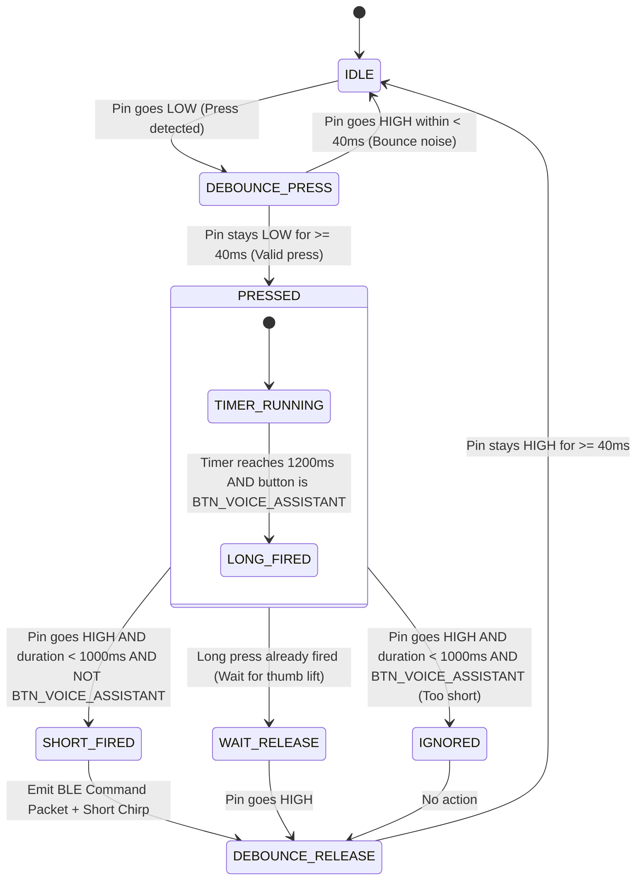

# Physical Button Specification — Smart Rider HMI

## 1. Overview & Ergonomic Philosophy

The Smart Rider HMI remote is designed to be mounted on the handlebar of a two-wheeler (adjacent to the left switchgear / clutch perch for easy thumb access). Because motorcycle and scooter riders frequently wear thick leather or textile gloves and must operate controls without looking, the physical button subsystem must meet strict ergonomic, electrical, and behavioral requirements:

- **High Tactile Feedback**: Switches with pronounced tactile click and 250–350 gf actuation force.
- **Sufficient Key Pitch**: Minimum 15 mm center-to-center spacing to avoid accidental adjacent presses.
- **Blind Identification**: Raised tactile markers (pips/bars) on primary anchor buttons.
- **Defensive State Machine**: Noise debouncing, multi-key press lockout, and explicit short/long press discrimination.

---

## 2. The Seven V1 Physical Controls

| # | Button Identifier | Action Type | Primary Function | Secondary / Contextual Function |
| :- | :--- | :--- | :--- | :--- |
| **1** | `BTN_ANSWER_CALL` | Short Press | Accept incoming phone call | Inactive when not ringing |
| **2** | `BTN_REJECT_END_CALL`| Short Press | Reject incoming phone call | Terminate active in-progress call |
| **3** | `BTN_PLAY_PAUSE` | Short Press | Toggle media playback (Play/Pause)| Resume playback after call ends |
| **4** | `BTN_NEXT_TRACK` | Short Press | Skip to next audio track | Inactive during active call |
| **5** | `BTN_PREV_TRACK` | Short Press | Restart / skip to previous track| Inactive during active call |
| **6** | `BTN_QUICK_NAV` | Short Press | Launch turn-by-turn navigation | Re-center active navigation |
| **7** | `BTN_VOICE_ASSISTANT`| Long Press (~1.2s)| Activate Voice Assistant | Cancel ongoing voice interaction |

> **Design Principle**: Buttons 1 through 6 respond exclusively to **Short Presses** to ensure instant response. Button 7 (`BTN_VOICE_ASSISTANT`) requires a **Long Press** (1.2 seconds) to prevent accidental speech triggers caused by inadvertent road bumps or brush contact.

---

## 3. Hardware Electrical Specification

### 3.1 Circuit Topology
- **Switch Configuration**: Active-Low momentary Single-Pole Single-Throw (SPST).
- **Internal Pull-Ups**: Configured with ESP32 internal pull-up resistors (`INPUT_PULLUP`, typical value $\approx 45\text{ k}\Omega$).
- **Logic State**:
  - Unpressed: Logic HIGH ($3.3\text{ V}$).
  - Pressed: Logic LOW ($0.0\text{ V}$, connected to GND).
- **Physical Filtering**: Optional $100\text{ nF}$ ceramic bypass capacitor in parallel with each switch to eliminate high-frequency RF/spark-plug interference on motorcycles.

### 3.2 ESP32 Pin Allocation (ESP32-WROOM-32)

| Button Identifier | ESP32 GPIO | Pin Characteristics | Internal Pull-Up |
| :--- | :--- | :--- | :--- |
| `BTN_ANSWER_CALL` | GPIO 18 | Standard I/O, RTC wake-up capable | Yes |
| `BTN_REJECT_END_CALL` | GPIO 19 | Standard I/O, RTC wake-up capable | Yes |
| `BTN_PLAY_PAUSE` | GPIO 21 | Standard I/O, RTC wake-up capable | Yes |
| `BTN_NEXT_TRACK` | GPIO 22 | Standard I/O, RTC wake-up capable | Yes |
| `BTN_PREV_TRACK` | GPIO 23 | Standard I/O, RTC wake-up capable | Yes |
| `BTN_QUICK_NAV` | GPIO 25 | Standard I/O, RTC wake-up capable | Yes |
| `BTN_VOICE_ASSISTANT` | GPIO 26 | Standard I/O, RTC wake-up capable | Yes |
| `LED_STATUS_BLUE` | GPIO 32 | BLE Status LED (PWM or digital) | Output |
| `LED_STATUS_GREEN` | GPIO 33 | Action Feedback LED | Output |
| `BUZZER_PIN` | GPIO 27 | Active Piezo Buzzer / PWM tone | Output |

*(Note: Strapping pins GPIO 0, 2, 12, 15 and input-only pins GPIO 34–39 are deliberately avoided for button lines to ensure reliable boot behavior and active pull-up support).*

---

## 4. Debounce and Press Detection State Machine

### 4.1 Timing Thresholds
- **Debounce Interval ($T_{\text{debounce}}$)**: **$40\text{ ms}$**. Any state transitions shorter than this interval are treated as mechanical switch contact chatter and discarded.
- **Short Press Valid Range**: **$50\text{ ms} \le T_{\text{press}} < 1000\text{ ms}$**. Triggered on button **release** (`FALLING -> RISING`).
- **Long Press Threshold ($T_{\text{long}}$)**: **$1200\text{ ms}$**. Triggered **immediately** when the button has been held continuously for $1200\text{ ms}$ (does not wait for release). Once the long-press threshold is reached, an acoustic confirmation beep is sounded so the rider knows they can release their thumb.
- **Multi-Key Lockout**: If two or more buttons are pressed simultaneously (e.g. thumb rolls across two buttons), the state machine locks out command generation until all buttons are fully released.

### 4.2 State Transition Diagram

---

## 5. System State Context & Button Behavior Matrix

The Android companion app serves as the context arbiter. The ESP32 simply transmits the raw semantic button events; the Android app routes them depending on current smartphone state:

| Event Transmitted | Phone State: Idle | Phone State: Incoming Call | Phone State: In Call | Phone State: Music Playing |
| :--- | :--- | :--- | :--- | :--- |
| `CMD_ANSWER_CALL` | No-op (or audio beep) | **Accepts Call**; silences ringer | No-op | No-op |
| `CMD_REJECT_END_CALL`| No-op | **Rejects Call**; silences ringer | **Terminates Call**; restores media | No-op |
| `CMD_PLAY_PAUSE` | Resumes last media app | Mutes ringer ringtone | No-op (prevent audio interference)| **Pauses playback** |
| `CMD_NEXT_TRACK` | Skips track | Ignored | Ignored | **Skips to next song** |
| `CMD_PREV_TRACK` | Rewinds / Previous | Ignored | Ignored | **Rewinds / Previous song** |
| `CMD_OPEN_SAVED_NAV` | **Launches Google Maps** to saved destination | Ignored | Ignored | **Launches Google Maps** (audio continues) |
| `CMD_ACTIVATE_VOICE` | **Opens Voice Assistant** (starts listening) | Spoken Caller Announcement repeat | Ignored | **Ducks music**, listens for voice command |

---

## 6. Feedback & Acoustic Signaling Specification

Acoustic feedback is provided by a miniature onboard $5\text{ V}$ piezo buzzer driven via an NPN transistor from the ESP32. Visual feedback is provided by dual LEDs:

### 6.1 Buzzer Acoustic Signatures

| Scenario | Tone Pattern | Frequency | Duration |
| :--- | :--- | :--- | :--- |
| **Short Button Press** | Single sharp click | $2.4\text{ kHz}$ | $30\text{ ms}$ |
| **Long Press Confirmed**| Ascending dual chirp | $2.0\text{ kHz} \rightarrow 3.0\text{ kHz}$ | $50\text{ ms} + 75\text{ ms}$ |
| **BLE Connected** | Double high beep | $3.2\text{ kHz}$ | $60\text{ ms}$ on, $40\text{ ms}$ off, $60\text{ ms}$ on |
| **BLE Disconnected** | Descending low buzz | $1.2\text{ kHz} \rightarrow 800\text{ Hz}$ | $150\text{ ms} + 150\text{ ms}$ |
| **Error / NACK** | Triple low pulse | $600\text{ Hz}$ | $3\times (40\text{ ms} \text{ on}, 40\text{ ms} \text{ off})$ |

### 6.2 LED Visual Signatures

| Remote Mode | Blue LED (`LED_STATUS_BLUE`) | Green LED (`LED_STATUS_GREEN`) |
| :--- | :--- | :--- |
| **Advertising / Unpaired** | Fast blink ($2\text{ Hz}$, $250\text{ ms}$ ON / OFF) | OFF |
| **BLE Connected (Normal)**| Solid ON (low brightness / PWM $20\%$) | OFF |
| **Command Transmitting** | Solid ON | Single $80\text{ ms}$ flash |
| **Low Remote Battery** | Slow pulsing heartbeat | Fast double red/amber blink |
| **Deep Sleep Standby** | OFF | OFF |

---

## 7. Voice Command Parity & Spoken Announcements

To ensure complete hands-free redundancy, all button functions have exact voice assistant equivalents:

| Voice Utterance | Equivalent Button Action | Response / Outcome |
| :--- | :--- | :--- |
| *"Answer call"* / *"Pick up"* | `BTN_ANSWER_CALL` | Call accepted |
| *"Reject call"* / *"Decline"* | `BTN_REJECT_END_CALL` | Call dismissed |
| *"Pause music"* / *"Play music"*| `BTN_PLAY_PAUSE` | Media toggled |
| *"Next track"* / *"Skip song"* | `BTN_NEXT_TRACK` | Next song played |
| *"Previous song"* / *"Restart"* | `BTN_PREV_TRACK` | Previous song |
| *"Navigate home"* / *"Take me home"*| `BTN_QUICK_NAV` | Maps launched to saved destination |
| *"What's the weather ahead?"* | Voice-exclusive query | Spoken weather forecast along route |
| *"Next turn"* | Voice-exclusive query | Spoken next navigation instruction |

### 7.1 Caller Announcement Spoken Script
When a call arrives and contacts permission is granted:
- If caller matches contact address book:
  > *"Incoming call from [Contact Name]. Press Answer or say 'Answer call'."*
- If unknown number:
  > *"Incoming call from [Phone Number or 'Unknown Caller']."*
- Announcements repeat every 6 seconds until answered, rejected, or timed out.
