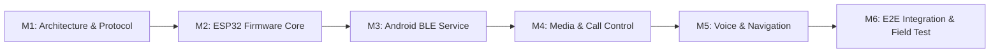

# Development Roadmap & Simulation Strategy — Smart Rider HMI

## 1. Phased Development Roadmap

The development of Smart Rider HMI is structured into six focused milestones to ensure incremental validation of hardware, BLE communications, Android system integration, and rider ergonomics.

---

### Milestone 1 (M1) — Architecture, Protocol & Repository Initialization *(Current)*
- **Objectives**: Complete system architecture, physical button specification, versioned binary BLE protocol specification, Android permissions and limitations analysis, project scaffold, and simulation strategy.
- **Deliverables**:
  - Isolated Git repository (`Smart-Rider-HMI`).
  - Architecture, button, protocol, permissions, and roadmap documentation (`docs/`).
  - Protocol test suite and Python simulator (`simulator/`, `tests/`).
  - ESP32 hardware header configurations (`esp32-firmware/include/`).
  - Android application architecture layout (`android-app/`).

---

### Milestone 2 (M2) — ESP32 Firmware Core & Button State Machine
- **Objectives**: Implement rock-solid button debouncing, long-press detection, and BLE GATT server functionality on the ESP32.
- **Tasks**:
  1. Implement non-blocking button state machine for 7 GPIO pins with 40ms software debounce.
  2. Implement proactive 1.2s long-press detection for `BTN_VOICE_ASSISTANT` with acoustic confirmation.
  3. Implement simultaneous multi-button press lockout to prevent spurious commands.
  4. Implement NimBLE / ESP32 BLE GATT Server with `Smart Rider Service`, `Command TX`, and `App Control RX`.
  5. Implement binary packet packing, sequence numbering, and CRC-8-CCITT computation.
  6. Implement retransmission with exponential backoff if ACK not received within 250ms.
  7. Implement local buzzer feedback and status LED indicators.
  8. Implement deep-sleep power saving with RTC GPIO wake-up interrupts.
- **Verification**: Verify packet output via Wokwi ESP32 simulator and nRF Connect mobile app.

---

### Milestone 3 (M3) — Android BLE Companion Layer & Foreground Service
- **Objectives**: Build the persistent Android background layer that maintains communication with the handlebar remote.
- **Tasks**:
  1. Implement `SmartRiderService` as a persistent Android Foreground Service (`foregroundServiceType="connectedDevice"`).
  2. Implement `BleScanner` with custom `ScanFilter` for `SmartRider-Remote`.
  3. Implement automatic BLE reconnection with exponential backoff on connection loss.
  4. Implement binary protocol parser, CRC-8 validation, and sequence counter deduplication window.
  5. Implement outgoing ACK generation and phone state synchronization.
  6. Create Jetpack Compose onboarding UI for BLE scanning, pairing, and RSSI signal monitoring.
- **Verification**: Test bidirectional communication between real Android device / emulator and ESP32 remote (or Python protocol mock).

---

### Milestone 4 (M4) — Media Controls & Call Management Integration
- **Objectives**: Connect decoded button commands to Android phone telephony and media sessions.
- **Tasks**:
  1. Implement `SmartRiderNotificationListener` extending `NotificationListenerService` to bind to `MediaSessionManager`.
  2. Map `CMD_PLAY_PAUSE`, `CMD_NEXT_TRACK`, and `CMD_PREV_TRACK` to active `TransportControls`.
  3. Implement `TelephonyCallback` / `PhoneStateListener` to track call states (`IDLE`, `RINGING`, `OFFHOOK`).
  4. Implement caller contact lookup via `ContactsContract.PhoneLookup`.
  5. Implement `TextToSpeech` caller announcement ("Incoming call from Rahul").
  6. Map `CMD_ANSWER_CALL` to `TelecomManager.acceptRingingCall()` and `CMD_REJECT_END_CALL` to `TelecomManager.endCall()`.
  7. Handle audio focus management: duck music during incoming call ring and caller announcement.
- **Verification**: In-app simulated incoming call tests and playback control tests across Spotify / YouTube Music.

---

### Milestone 5 (M5) — Voice Assistant & Quick Navigation
- **Objectives**: Enable hands-free voice interactions and instant navigation to the rider's saved destination.
- **Tasks**:
  1. Implement `SpeechRecognizer` pipeline triggered by `CMD_ACTIVATE_VOICE`.
  2. Implement voice prompt chime and speech-to-text listener with transient audio ducking.
  3. Implement rider-specific natural language parser for intents:
     - *"Navigate [home/work/office]"*
     - *"Weather ahead"* / *"Will it rain?"*
     - *"Next track"* / *"Pause music"*
     - *"Call [contact]"*
  4. Implement Quick Navigation handler: launch Google Maps navigation intent (`google.navigation:q=lat,lng&mode=d`) to saved destination stored in DataStore.
  5. Implement Open-Meteo REST client: query free weather forecast for current GPS location and speak advance precipitation warnings.
- **Verification**: Voice recognition test in ambient ride noise simulation; Maps intent launch test.

---

### Milestone 6 (M6) — End-to-End Integration, Field Validation & Enclosure
- **Objectives**: Validate the complete hardware and software stack in real motorcycle riding conditions.
- **Tasks**:
  1. Design compact 3D-printable handlebar clamp enclosure (22mm / 7/8" and 28mm / 1-1/8" handlebar diameters).
  2. Weatherproofing: silicone membrane / tactile button boots for IP54 water/dust resistance.
  3. Glove-usability testing with thick winter and leather riding gloves.
  4. Road vibration test: ensure no false button triggers from engine vibration or potholes.
  5. Battery life optimization: achieve $>25\text{ hours}$ active riding time per charge.
  6. End-to-end latency benchmark: $<50\text{ ms}$ from button click to Android response.

---

## 2. Firmware Simulation & Validation Strategy

Validating embedded firmware and BLE communication before physical PCB assembly is crucial for rapid, defect-free iteration.

### 2.1 Simulation Environment Evaluation

| Platform | Capabilities | BLE Support | Suitability for Smart Rider HMI |
| :--- | :--- | :--- | :--- |
| **Tinkercad** | Arduino Uno (ATmega328P), basic pushbuttons, LEDs, breadboards | **No BLE** | **Low**: Useful only for educational verification of basic pullup resistor wiring and naive debounce loops. Cannot simulate ESP32, FreeRTOS tasks, or BLE GATT. |
| **Wokwi** | Native ESP32 emulation, multi-core, GPIO interrupts, pushbuttons, LEDs, OLED displays, buzzer | **Experimental BLE** / Serial diagnostics | **High**: Excellent for validating debouncing, long-press timer logic, state machines, and logging serial protocol packets. |
| **Python Virtual Remote Simulator** | Cross-platform Python script (`simulator/protocol_simulator.py`) using `socket` or Bleak / BLE virtual peripheral | Full Protocol V1 simulation | **Very High**: Allows full automated unit testing of packet generation, CRC-8, sequence rolling, and Android BLE client integration without physical hardware. |
| **Physical ESP32 Dev Kit** | ESP32-WROOM-32 dev board + 7 breadboard tactile buttons | Full real-world BLE 4.2 | **Primary Target**: Ultimate gold standard for RF performance, BLE bonding, and Android hardware latency validation. |

### 2.2 Simulation Workflow for Development
1. **Logic & Protocol Validation**:
   Run `python -m pytest tests/` to verify protocol packet serialization, CRC-8 calculation, and edge-case handling.
2. **Firmware State Machine Simulation**:
   Load `simulator/wokwi_diagram.json` into Wokwi (online or VS Code Wokwi extension) to test the 7-button state machine, debounce timings, and serial packet stream.
3. **Android Client Validation**:
   Use the Python virtual protocol simulator or an Android virtual BLE peripheral app to feed test packets into `SmartRiderService` on the Android development device.

---

## 3. Testing Matrix

| Test Suite | Scope | Target | Tool / Framework |
| :--- | :--- | :--- | :--- |
| **Protocol Unit Tests** | Packet framing, byte offsets, CRC-8, edge payloads | Host Machine | Python `pytest` |
| **Debounce & Timing Tests** | Noise spike rejection (<40ms), short vs long press | Firmware / Sim | Wokwi & Unity test runner |
| **Duplicate Prevention Tests**| Resent packets within 1.5s sliding window | Android Client | JUnit 4 + Mockito |
| **BLE Link Loss Recovery** | Abrupt disconnect, auto-reconnect backoff | Hardware / Phone | nRF Connect & Android Studio Profiler |
| **Call Intercept Tests** | Ringing detection, contact name resolution, accept/end | Android Client | Android Emulator Call Injection |
| **Media Transport Tests** | Play, pause, skip across Spotify & YouTube Music | Android Client | Physical Android Phone |
| **Voice Activation Latency** | Long press to speech recognition listening beep | Full System | High-speed audio recorder (<250ms target)|
